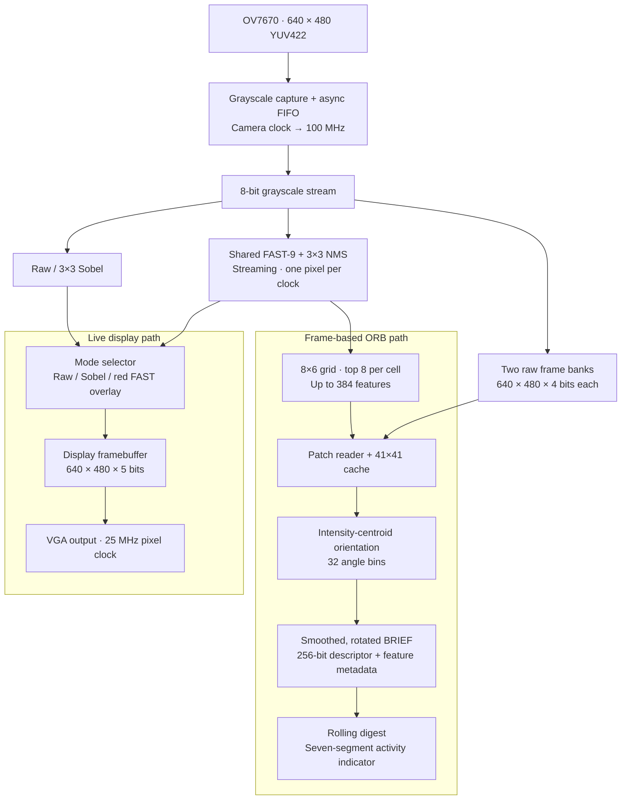

# FPGA Camera Accelerator

Real-time grayscale, Sobel edges, and FAST keypoint overlays from an **OV7670 camera** on the **Nexys A7-100T**, with a connected **single-scale ORB descriptor engine**.

**640 × 480 video · 100 MHz processing · FAST-9 + NMS · 256-bit descriptors**

## Architecture



- **Shared detection:** one continuously running FAST pipeline feeds both the VGA overlay and ORB selection.
- **Three framebuffers:** one processed display buffer plus two raw ORB banks storing the upper four grayscale bits. VGA runs independently of descriptor extraction.
- **Frame ownership:** ORB alternates banks between accepted frames, serializes capture and description, and skips camera frames while busy.
- **Tagged output:** each descriptor carries coordinates, FAST score, orientation, frame ID, and a system-clock timestamp through a ready/valid interface.

The board top is [`vga_test_top.v`](camera_accelerator.srcs/sources_1/new/vga_test_top.v). Display routing lives in [`runtime_pipeline_selector.v`](camera_accelerator.srcs/sources_1/new/runtime_pipeline_selector.v); descriptor processing is integrated by [`orb_accelerator.v`](camera_accelerator.srcs/sources_1/new/orb_accelerator.v). See [ORB architecture and interfaces](docs/ORB.md) for implementation details.

## Board controls

The camera must already be configured for **640 × 480 YUV422**.

| Control | Function |
| --- | --- |
| `SW0` | Select captured byte phase for the camera stream |
| `SW2=0`, `SW1=0` | Live grayscale |
| `SW2=0`, `SW1=1` | Sobel edges |
| `SW2=1` | FAST overlay; overrides `SW1` |
| `SW15:SW12` | Sobel threshold: 0–375, step 25; FAST threshold: 5–80, step 5 |

The seven-segment display shows `LIVE`, the Sobel threshold, or the FAST threshold and last-frame keypoint count. Red markers and the numeric count represent FAST detections; decimal points indicate digest-based ORB activity.

## Build and verify

Build with Vivado 2024.1 from the repository root:

```powershell
& 'C:\Xilinx\Vivado\2024.1\bin\vivado.bat' -mode batch -source tools/build_orb_board.tcl -tclargs (Get-Location).Path
```

The build writes reports and `orb_board.bit` under `orb_test_output/board_<timestamp>/` without programming the FPGA. It requires the external constraints file at `../OneDrive/Documents/ChatGPT/FPGA Side Projects/nexys_a7_vga_test.xdc`; provide that file or update the path in the build script.

FAST verification uses Icarus Verilog, NumPy, and OpenCV to compare RTL keypoint positions and scores against two independent references:

```sh
python tools/fast_check.py --quick
python tools/fast_check.py          # includes 640×480 cases
```

ORB verification coverage, recovery of locally excluded test sources, and routed build reports are documented in [docs/ORB.md](docs/ORB.md#verification-and-reports).

## Implementation status

The recorded **2026-10-02 routed build** used 19.78% LUTs, **134.5/135 BRAM tiles (99.63%)**, and 7 DSPs, with +0.385 ns setup slack and +0.022 ns hold slack under the supplied constraints.

- At 100 MHz, 384 descriptors take approximately **83 ms plus capture time**.
- This quantized, single-scale variant is **not bit-compatible with OpenCV ORB**.
- Descriptors currently feed an on-board digest; host transport, matching, and pose estimation are not implemented.
- On-device validation, real-scene descriptor evaluation, and external I/O timing constraints remain. Internal timing closure is not complete camera-interface sign-off.

Next priorities are hardware validation, descriptor export, and host-side matching. Further FPGA features will require revisiting the nearly full BRAM allocation.
